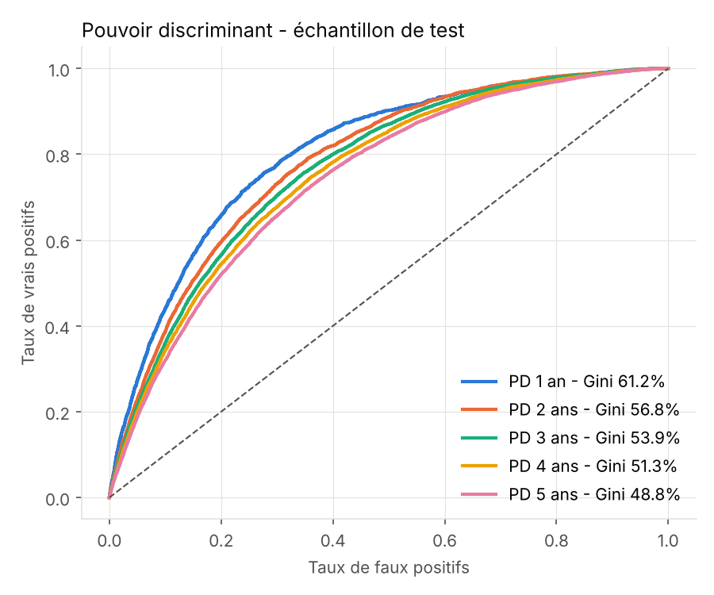
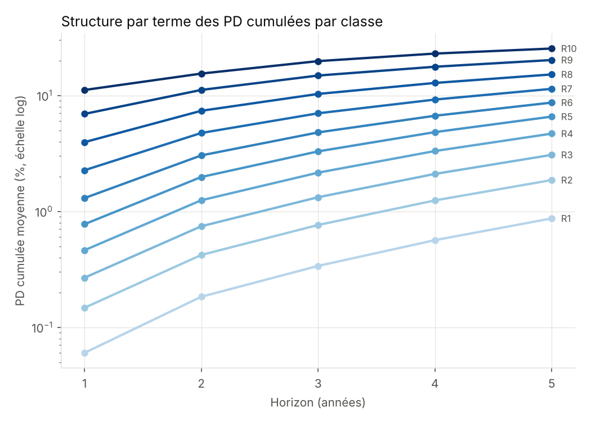
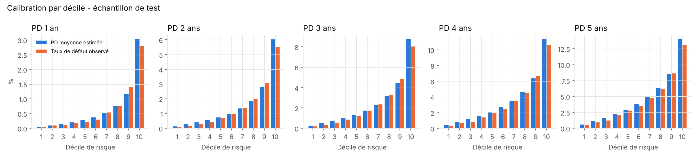

# Probability of Default Models for French SMEs (1- to 5-year horizons)

Five cumulative PD models (1Y, 2Y, 3Y, 4Y, 5Y) for French small and medium-sized enterprises, built end-to-end from French open data: financial statements, company register and court insolvency filings.

**Author:** Laurent Motais de Narbonne — Senior Risk Manager · [LinkedIn](https://www.linkedin.com/in/laurent-motais-de-narbonne/) · [Publications](https://ldenarbonne.github.io/)

---

## Key results

| Horizon | Gini — V1 (P&L only) | Gini — V2 logit (test) | Gini — V2 logit (out-of-time) | Gini — V2 LightGBM (test) |
|---|---|---|---|---|
| 1 year | 46.9% | **61.2%** | 56.3% | 70.1% |
| 2 years | 45.3% | **56.8%** | 51.7% | 67.3% |
| 3 years | 40.4% | **53.9%** | 49.4% | 64.9% |
| 4 years | 39.2% | **51.3%** | 47.4% | 62.7% |
| 5 years | 38.6% | **48.8%** | 46.4% | 60.7% |

- Adding **balance-sheet ratios** lifts the Gini by **10 to 14 points** at every horizon.
- The LightGBM challenger reaches **70% at 1 year**, in line with the Banque de France rating system (71%–77% at 1 year, [2025 performance report](https://www.banque-france.fr/system/files/2025-12/FR_Eval_performances_cotation_2025_VClean.pdf)).
- Observed default rates increase monotonically across the 10-grade master scale at every horizon.

<p align="center">
  
  
</p>
<p align="center"></p>

---

## Data

| Role | Source | Licence |
|---|---|---|
| Financial ratios (V2) | [Ratios Financiers (BCE / INPI)](https://data.economie.gouv.fr/explore/dataset/ratios_inpi_bce/), French Ministry of Economy — 6.8M company-years, closings 2016–2025 | Licence Ouverte 2.0 (Etalab) |
| Company register | [SIRENE (INSEE)](https://public.opendatasoft.com/explore/dataset/economicref-france-sirene-v3/) — incorporation date, legal form, NACE sector, location, headcount band | Licence Ouverte 2.0 |
| Default events | [BODACC (DILA)](https://bodacc-datadila.opendatasoft.com/explore/dataset/annonces-commerciales/) — court openings of safeguard, receivership and liquidation, 2008–2026 | Licence Ouverte 2.0 |
| P&L data (V1) | Kaggle — [Financial data of French companies](https://www.kaggle.com/datasets/briaclg/financial-data-of-french-compagnies) (INPI extraction, fiscal years 2012–2016) | See Kaggle page |

Raw data are **not** stored in this repository (over 1 GB). The scripts download or rebuild everything from the sources above.

---

## Methodology

**Default definition.** First court opening of safeguard (*sauvegarde*), receivership (*redressement judiciaire*) or liquidation (*liquidation judiciaire*) published in the BODACC. This is a legal default, close to the Banque de France definition. It is not the Basel 90-days-past-due definition.

**Observation date.** Fiscal year-end + 7 months (legal deadline for approving and filing accounts), so the model only uses information available at scoring time. Companies already in insolvency proceedings at that date are excluded. Targets whose horizon is not fully observed are set to missing rather than to non-default.

**Scope.** Commercial companies, turnover ≤ €50M, fewer than 250 employees. Finance (NACE K), public administration (O) and extraterritorial bodies (U) are excluded.

**Candidate variables (26).** Equity ratio, negative equity, gearing, current ratio, asset age, working capital, receivable / payable / inventory days, interest burden, cash flow / sales, debt repayment capacity, margins, size, age, sales growth, change in equity ratio, filing type, confidential P&L flag, sector, region and legal form.

**Data cleaning.**
- Confidential P&L figures, reported as 0 in the source, are reset to missing.
- Ratios are winsorised at the 1st and 99th percentiles.
- Infinite values are set to missing; exact duplicates are removed.
- No imputation: missing values get their own WoE bin.

**Champion model.** Logistic regression on Weight-of-Evidence variables, one model per horizon:
- monotonic binning;
- Information Value ≥ 0.02;
- correlation filter |ρ| ≤ 0.6;
- forward selection on BIC, with expected-sign and p-value < 1% constraints;
- VIF check.

**Challenger model.** LightGBM, with the number of iterations tuned by group K-fold cross-validation.

**Validation.**
- Development sample: closings 2016–2019, split 70/30 by company, so a firm never appears in both train and test.
- Out-of-time sample: closings from 2020 onwards.
- Metrics: Gini, KS, Brier score, decile calibration, Hosmer-Lemeshow.

**Term structure.** PDs are made non-decreasing across horizons with a cumulative maximum. Only 1.3% of firms needed this correction in V2, against 11.6% in V1.

---

## Findings worth highlighting

1. **Survivorship bias in the Kaggle dataset (V1).** The data come from INPI filings made after 2017, so firms that failed earlier never appear. With a standard observation date, the 2-year default rate of the 2012 cohort was 1.2% versus 4.8% at 5 years. Re-anchoring the observation date on the actual BODACC filing date removed the bias.
2. **Balance-sheet data matter.** Liquidity and the equity ratio are the strongest predictors at every horizon. They are absent from P&L-only data.
3. **Post-Covid miscalibration.** On closings from 2020 onwards, the models rank firms well (out-of-time Gini of 56% at 1Y) but underestimate the default *level* (mean PD 0.55% vs 0.82% observed at 1Y). Likely drivers: state-guaranteed loans (PGE) inflating cash and equity ratios, followed by the 2023–2024 surge in insolvencies. **Central-tendency recalibration** on a through-the-cycle average would be required before any use.

## Limitations

- Legal default, not Basel default: PDs must be recalibrated for IRB or IFRS 9 use.
- Fiscal-year length is not available in the source, so short fiscal years may distort flow-based ratios.
- The SIRENE headcount band and sector reflect the current state; they are used for scoping only (headcount is excluded as a predictor to avoid look-ahead bias).
- Separate models per horizon: a discrete-time survival model would guarantee a consistent term structure by construction.

---

## Repository structure

```
├── PD_PME_France_modeles_bilan.xlsx   Full results workbook (V2): performance, coefficients,
│                                      WoE scorecards, IV, calibration, master scale, data quality
├── v1_kaggle/                         V1 — P&L-only models (Kaggle + BODACC)
│   ├── 00a/00b_*_reduce.py            BODACC extraction helpers
│   ├── 01_build_dataset.py            Dataset build, survivorship-bias correction
│   ├── 02_models.py                   WoE logit + LightGBM, 5 horizons
│   ├── 03_report.py                   Charts and Excel workbook
│   └── outputs/
└── v2_balance_sheet/                  V2 — balance-sheet models (BCE/INPI + SIRENE + BODACC)
    ├── 10_sirene_reduce.py            SIRENE extraction helper
    ├── 11_build_bilan.py              Dataset build and cleaning
    ├── 12_models_bilan.py             WoE logit + LightGBM, 5 horizons
    ├── 13_report_bilan.py             Charts, Excel workbook, V1/V2 comparison
    ├── 14_qualite_donnees.py          Missing values and redundancy analysis
    └── outputs/
```

Detailed methodological notes in French: `v1_kaggle/README_FR.md`, `v2_balance_sheet/README_FR.md`.

## Reproduction

```bash
pip install -r requirements.txt
cd v2_balance_sheet
python 11_build_bilan.py <ratios_dir> <sirene.csv> <bodacc_openings.csv> base_bilan.csv
python 12_models_bilan.py base_bilan.csv outputs/ 2020-01-01 0.5
python 13_report_bilan.py outputs/ ../v1_kaggle/outputs/performance.csv
python 14_qualite_donnees.py base_bilan.csv outputs/PD_PME_France_modeles_bilan.xlsx
```

## Licence

Code released under the MIT licence. Data remain subject to their original licences (see table above).
